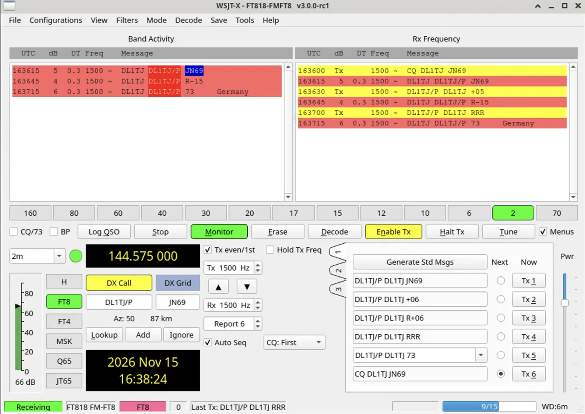

# Results

**First results: FT8 contacts via FM completed between two of my own stations.**

On 2026-11-15 I completed four FT8 exchanges on 144.575 MHz between a Yaesu FT-60
handheld and a Yaesu FT-818, both running unmodified WSJT-X. The two radios were about
10 m apart, so the signal reports say nothing about range. The
[report](#2026-11-15-ft-60-and-ft-818) is below.

This was a first try, not a run of [TEST_PLAN.md](TEST_PLAN.md). It answers the question of
test 2 (does standard FT8 get from one FM radio to another at all) with yes, and nothing
more: none of the eight tests has been carried out as written, and every other performance
statement in this repository is still an expectation.

I add results here only when they come from an actual test, mine or one reported to me,
with the details needed to repeat it.

## Summary

| Test | Status | Reports |
|---|---|---|
| 1 Audio loopback | open | - |
| 2 Two-station RF link | partly: full contacts completed; ten-slot counts not run | [2026-11-15](#2026-11-15-ft-60-and-ft-818) |
| 3 PTT start-up delay | open (DT as reported by WSJT-X noted, no delay measurement) | [2026-11-15](#2026-11-15-ft-60-and-ft-818) |
| 4 FM deviation | open | - |
| 5 Audio frequency response | open (harmonics seen, not measured) | [2026-11-15](#2026-11-15-ft-60-and-ft-818) |
| 6 Weak-signal decoding | open | - |
| 7 Narrow versus wide FM | open | - |
| 8 Real-world range | open | - |

## Radios tested

| Radio | Interface | Narrow/wide | Result | Report |
|---|---|---|---|---|
| Yaesu FT-60 | Digirig Lite, audio-triggered PTT | wide, later narrow | Decoded by the FT-818 at +3 to +7 dB, DT 0.3 s. Full contacts completed. | [2026-11-15](#2026-11-15-ft-60-and-ft-818) |
| Yaesu FT-818 | Digirig Mobile, PTT on RTS | narrow | Decoded by the FT-60 at 0 to +37 dB, DT 0.1 to 0.2 s. Full contacts completed. | [2026-11-15](#2026-11-15-ft-60-and-ft-818) |

## Contacts

| Date (UTC) | Stations | Distance | Report |
|---|---|---|---|
| 2026-11-15 15:53 to 15:54 | DL1TJ/P (FT-60), DL1TJ (FT-818) | about 10 m | [2026-11-15](#2026-11-15-ft-60-and-ft-818) |
| 2026-11-15 16:00 to 16:01 | DL1TJ/P (FT-60), DL1TJ (FT-818) | about 10 m | [2026-11-15](#2026-11-15-ft-60-and-ft-818) |
| 2026-11-15 16:25 to 16:26 | DL1TJ/P (FT-60), DL1TJ (FT-818) | about 10 m | [2026-11-15](#2026-11-15-ft-60-and-ft-818) |
| 2026-11-15 16:32 to 16:37 | DL1TJ/P (FT-60), DL1TJ (FT-818) | about 10 m | [2026-11-15](#2026-11-15-ft-60-and-ft-818) |

All four are between my own two stations. They show that the chain works; they are not
contacts with another operator.

---

## 2026-11-15: FT-60 and FT-818

On the air, 144.575 MHz, between 15:50 and 16:50 UTC. Both stations are mine and stood on
the same property, about 10 m apart: the FT-60 inside the house, the FT-818 outside. At
that distance both receivers get a strong signal, so the reports below describe the audio
chain, not the radio path.

### Stations

| | Station A | Station B |
|---|---|---|
| Callsign | DL1TJ/P | DL1TJ |
| Radio | Yaesu FT-60 (handheld) | Yaesu FT-818 |
| Location | inside the house | outside, about 10 m away |
| Antenna | stock rubber antenna on the radio | Diamond X-30, about 3 m above ground |
| Mode | wide FM for the contacts at 15:53 and 16:00, narrow FM for those at 16:25 and 16:32 | narrow FM (as set before the session, not checked again) |
| Power | low (0.5 W) | lowest setting (1 W) |
| Squelch | fully open | not recorded |
| Interface | Digirig Lite | Digirig Mobile |
| PTT | triggered by the transmit audio | hardware, RTS line |
| WSJT-X | 3.0.1, macOS | 3.0.0-rc1, Ubuntu 26.04.1 LTS |
| Transmit tone | 800 Hz, then 1000 Hz, then 1500 Hz | 1500 Hz, 1000 Hz, 1500 Hz |
| Power slider | upper third at the end; changed during the session | upper third |
| Sound device level | output -10 dB, input +8 dB until about 16:18; output -20 dB, input 0 dB from about 16:20 | not recorded |
| Battery save | not recorded | does not apply |
| Firmware | not recorded | not recorded |

### What was measured

The numbers come from station A's `ALL.TXT`
([excerpt](2026-11-15/ALL-DL1TJ-P-FT60.txt), 130 lines) and from the reports station B
sent. Station B wrote no `ALL.TXT`: the option was switched off there.

- **Contacts:** four complete exchanges (both calls, a report each way, and RRR or RR73
  followed by 73). WSJT-X logged three of them.
- **FT-818 received on the FT-60:** 57 decodes. SNR 0 to +10 dB until 16:24:15, and +24 to
  +37 dB from 16:24:45 on, with one decode at +9 dB. Around that time I changed the audio
  level on station A's computer and switched the FT-60 from wide to narrow; I cannot say
  which of the two caused the jump. DT 0.1 to 0.2 s throughout.
- **FT-60 received on the FT-818:** the 24 reports station B sent range from +03 to +07 dB.
  DT 0.3 s on the three decodes in the [screenshot](2026-11-15/wsjtx-DL1TJ-FT818.webp).
- **Slots sent versus decoded:** not measured. Station A's log does not show which of
  station B's transmissions it missed, and for the reverse direction there is no log.
  The longest unbroken run in the log is station B's CQ from 16:46:00 to 16:49:30: eight
  consecutive transmissions, all decoded.
- **False decode:** one, at 16:21:15 (`ZS0OGZ S04RFT 19C NE`, -24 dB, DT 1.7 s).



The last contact as station A logged it (UTC, frequency in MHz, direction, mode, SNR, DT,
tone, message):

```
261115_163600   144.575 Rx FT8     33  0.1 1500 CQ DL1TJ JN69
261115_163615   144.575 Tx FT8      0  0.0 1500 DL1TJ DL1TJ/P JN69
261115_163630   144.575 Rx FT8     34  0.2 1500 DL1TJ/P DL1TJ +05
261115_163645   144.575 Tx FT8      0  0.0 1500 DL1TJ DL1TJ/P R-15
261115_163700   144.575 Rx FT8     37  0.1 1500 DL1TJ/P DL1TJ RRR
261115_163715   144.575 Tx FT8      0  0.0 1500 DL1TJ DL1TJ/P 73
```

The `R-15` is not a measurement: I advanced that step by hand (see below), and WSJT-X sent
the report it had in the field. The signal was decoded at +34 dB.

### What I observed

- **The contacts did not complete without manual help.** On station A, WSJT-X did not
  advance on its own after station B answered, although Auto Seq was switched on. From
  16:32:15 to 16:36:15 it sent its first message nine times while decoding station B's
  report each time, and from 15:50 to 15:51 it kept calling CQ while station B answered
  three times. Each contact continued once I selected the next message by hand. Station B
  sequenced on its own throughout. The likely cause is the test itself: both stations
  share the base callsign DL1TJ. I have not confirmed that with a different callsign.
- **Audio-triggered PTT needs level.** With the transmit audio turned down too far (sound
  device output at -30 dB, from about 16:18 to 16:20), the Digirig Lite no longer keyed
  the FT-60 and nothing was transmitted. With enough level it keyed every time and did
  not drop out during a transmission. The level needed to key the radio and the level the
  radio's modulator wants are set by the same control.
- **Unanswered calls.** Station A's CQ calls between 16:06 and 16:24 got no answer. I was
  adjusting station A during that period, and for part of it the FT-60 was not keying.
  Without a log from station B these calls cannot be counted as decode failures.
- **Harmonics.** Multiples of the FT-60's transmit tone were visible on station B's
  waterfall, strongest at the start with an 800 Hz tone and a high audio level. By the
  end of the session (1500 Hz tone, lower level, FT-60 on narrow) only faint lines
  remained while the FT-60 was transmitting. I did not measure their level or find where
  they arise (transmit audio, receive audio, or RF picked up by the audio cable).
  Decoding was not affected. Station A's waterfall showed none on the FT-818's signal.

### Not measured

Deviation, PTT start-up delay, decode rate per ten slots, anything at a distance or with
a weak signal, and FM voice on the same link (not tried).
